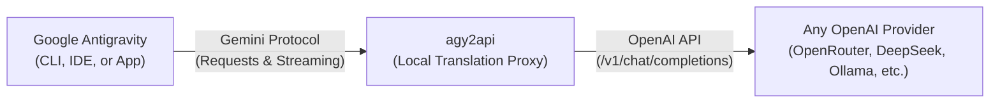

# agy2api (api2agy)

[](LICENSE)
[](https://www.python.org/downloads/)

A transparent, lightweight translation proxy and command-line companion connecting **Google Antigravity** (`agy` CLI, Antigravity Desktop IDE, and the Antigravity Desktop App) to any OpenAI-compatible provider (e.g. OpenRouter, DeepSeek, vLLM, Ollama, Together AI, Groq, or OpenAI).

---

## How It Works



---

## Key Features

- **Triple Antigravity Target Support**:
  - **`agy` CLI**: Run terminal sessions directly via `agy2api [prompt/args]`.
  - **Antigravity Desktop IDE**: Launch the VS Code-based Antigravity IDE via `agy2api --ide`.
  - **Antigravity Desktop App**: Launch the standalone Electron chat app via `agy2api --app`.
- **Attached Terminal Binding**:
  - The proxy lifecycle is bound directly to your terminal session.
  - Automatically launches the proxy, runs your app or CLI, and cleanly terminates the proxy as soon as the session or window closes.
- **Interactive 32-Model Manager TUI**:
  - Live fuzzy search through your upstream provider's model catalog with real-time keystroke matching.
  - Curate and manage up to 32 active models for the Antigravity UI model picker via `agy2api --model-setup`.
  - Instant Add (`Enter`), Remove (`Del`), and Navigation (`↑/↓`, `Tab`).
- **Session Model Override**:
  - Switch active models on a per-invocation basis: `agy2api --model <model_id>`.
- **High-Performance Streaming & Tool Calling**:
  - Real-time SSE translation with chunk-safe framing.
  - Bidirectional schema normalization, repair, and tool/function call translation.

---

## Installation

### Clone the Repository
```bash
git clone https://github.com/GoudaCouda/agy2api.git
cd agy2api
```

---

### Option 1: Via `uv` (Fastest & Recommended)

Install `agy2api` globally as an isolated tool:

```bash
# From the cloned repository directory
uv tool install .

# Or in editable mode for local development
uv tool install --editable .
```

Once installed, both `agy2api` and `api2agy` commands are globally available in your terminal.

---

### Option 2: Via `pipx`

```bash
pipx install .

# Or in editable mode
pipx install --editable .
```

---

### Option 3: Standard Python `pip`

```bash
pip install --user .

# Or for local development
pip install -e .
```

> **Run From Anywhere**: Once installed via `uv tool`, `pipx`, or `pip`, `agy2api` and `api2agy` are global commands in your PATH. You can run them from any directory or repository on your machine — you do **not** need to be inside the cloned `agy2api` folder.
>
> **Cross-Platform**: Fully compatible with both **Windows** (PowerShell, CMD, Windows Terminal) and **Linux** (Bash, Zsh) as well as macOS.

---

## How to Run

Choose whichever Antigravity target you want to use:

| Target | Command | Notes |
| :--- | :--- | :--- |
| **Antigravity CLI** | `agy2api` | Drop-in replacement for `agy` in your terminal. |
| **Antigravity Desktop IDE** | `agy2api --ide` | Launches the VS Code-based editor. |
| **Antigravity Desktop App** | `agy2api --app` | Launches the standalone desktop chat client. |

> **Model Override**: You can append `--model <model_id>` to any command above to run a specific model for that session (e.g. `agy2api --ide --model deepseek-chat`).

---

## Quick Start

### 1. Configure Your Provider (One-time Setup)

Run the interactive setup wizard:

```bash
agy2api --setup
```

*(You can also use the shorthand command `agy-setup`.)*

You will be prompted for:
- **Base URL**: e.g. `https://openrouter.ai/api/v1`, `https://api.deepseek.com/v1`, or `http://localhost:11434/v1`
- **API Key**: your provider API key
- **Model Selection TUI**: optionally launch the interactive 32-model manager to pick models from your provider
- **Default Model**: choose any model from your provider or curated list

Settings are saved directly to `~/.gemini/settings.json` (shared across Antigravity CLI, IDE, and Desktop App).

*(Alternatively, you can export standard environment variables: `OPENAI_BASE_URL` and `OPENAI_API_KEY`.)*

---

### 2. Interactive Model Manager (TUI)

Manage which models show up in your Antigravity IDE and App model picker:

```bash
agy2api --model-setup
```

- **Type** to live fuzzy-search your upstream provider's models.
- **[Enter]**: Add the highlighted model to your active 32-model list.
- **[Tab]**: Switch to the Selected list to inspect your models.
- **[Del] / [Backspace]**: Remove any model from the list.
- **[Esc]**: Save your selection and exit.

---

### 3. Search Live Models in Terminal

Quickly check what models are available upstream without opening a browser:

```bash
# Search models matching a query
agy2api models deepseek

# Search models matching multiple keywords
agy2api models "claude, gpt"

# List all models
agy2api models
```

---

### 4. Daemon & Proxy Management

By default, launching `agy2api`, `--ide`, or `--app` automatically manages the proxy attached to your terminal session. You can also inspect or manage the background proxy manually:

```bash
# Check running status and active configuration
agy2api --status

# View recent proxy logs
agy2api --logs

# Stop any running background proxy
agy2api --stop
```

---

## Supported OpenAI-Compatible Endpoints

`agy2api` supports **any standard OpenAI-compatible API endpoint**. You can use any of the providers below or point it to your own self-hosted inference servers:

| Provider | Base URL Example |
| :--- | :--- |
| **OpenRouter** | `https://openrouter.ai/api/v1` |
| **DeepSeek** | `https://api.deepseek.com/v1` |
| **Local Ollama** | `http://localhost:11434/v1` |
| **Local vLLM** | `http://localhost:8000/v1` |
| **OpenAI** | `https://api.openai.com/v1` |
| **Together AI** | `https://api.together.xyz/v1` |
| **Groq** | `https://api.groq.com/openai/v1` |
| **Any Custom Endpoint** | `https://your-custom-endpoint.com/v1` |

---

## Running Tests

Run the full pytest suite:

```bash
pytest
```

---

## License

This project is licensed under the [MIT License](LICENSE).
